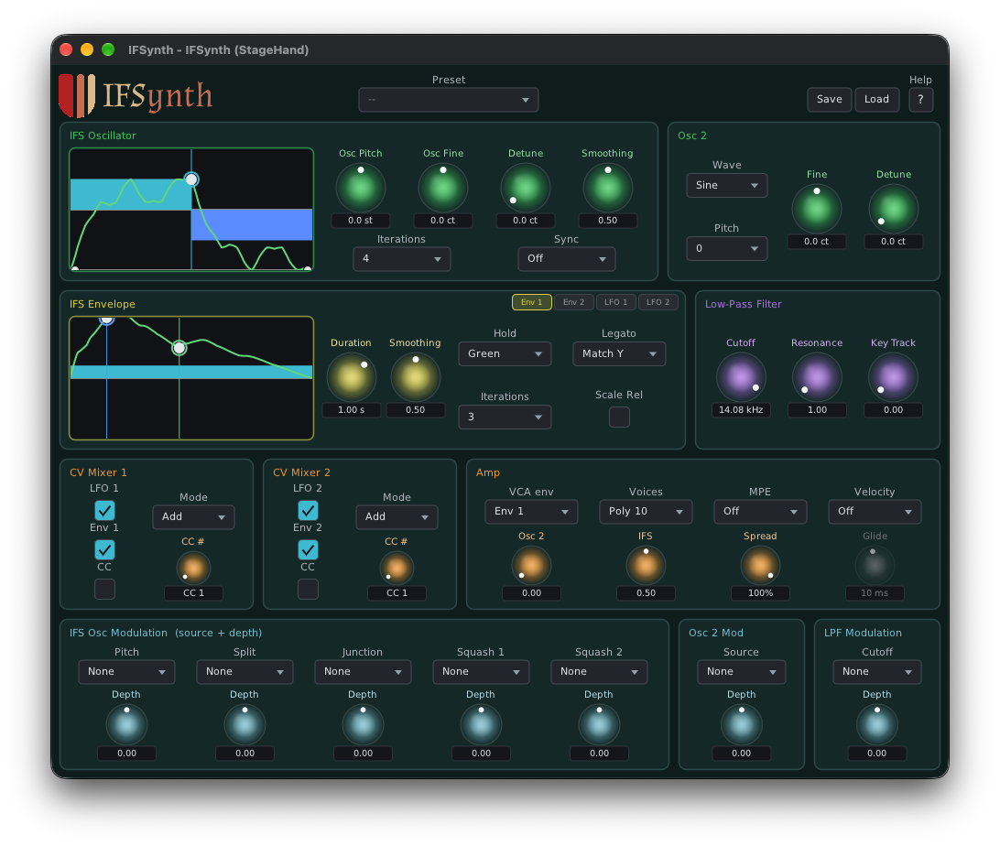

# IFSynth

A fractal synth from Unlikelyware: its oscillator, envelopes and LFOs are all shaped by IFS
(Iterated Function System) fractals, drawn and edited directly in the editor.



| | |
|---|---|
| Formats | CLAP. VST® 3 and AUv2 (macOS) build from source; ready-built in a later preview |
| Platforms | Linux x86-64, macOS 26 or later on Apple Silicon. No Windows |
| Version | 0.9.0 (preview) |
| License | MIT |

**Downloads:** ready-built plugins will be on itch.io with the 0.9 preview. This repo has the
source only.

## What makes it different

- **Fractal shapes you edit by hand.** The IFS oscillator's waveform is a two-transform fractal, and
  the two envelopes are three-transform fractals with hold and loop modes. Drag their points and
  hear the shape change. A second, plain oscillator can hard-sync the fractal one.
- **Modulation everywhere it counts.** Two LFOs, two CV mixers (an LFO, an envelope and a MIDI CC,
  added or multiplied), and pressure and timbre as sources for the fractal's pitch and shape, the
  filter and the second oscillator.
- **MIDI 2.0 first.** The plugin takes MIDI 2.0 notes directly, so a Pitch 7.9 note plays its exact
  microtonal pitch, not the nearest semitone: an EDO keyboard such as
  [KeyboardEDO](https://github.com/erickampman/KeyboardEDO) is heard as played. Per-note pitch bend,
  Pitch 7.25 and per-note controllers reach only the note they name. MIDI 1.0 works too.
- **MPE and CLAP note expressions.** An MPE switch for MPE controllers, and in hosts that send CLAP
  notes (Bitwig) tuning, pressure and brightness arrive per note.

The [help page](Resources/help.md), also behind the editor's Help button, describes every control.
[docs/how-it-works.md](docs/how-it-works.md) has the voice and the MIDI 2.0 details.

## Installing

The download holds `IFSynth.clap`. Put it in your CLAP folder (create the folder if it isn't there),
then rescan plugins in your host:

| | Linux | macOS |
|---|---|---|
| For you | `~/.clap` | `~/Library/Audio/Plug-Ins/CLAP` |
| For every user | `/usr/lib/clap` | `/Library/Audio/Plug-Ins/CLAP` |

On macOS, `~/Library` is hidden in Finder: Go ▸ Go to Folder opens it. The 0.9 previews aren't
notarized, so macOS won't load a downloaded plugin until its quarantine flag is cleared:

```bash
xattr -dr com.apple.quarantine ~/Library/Audio/Plug-Ins/CLAP/IFSynth.clap
```

A host that is already running keeps the plugins it loaded: quit and restart it. To build IFSynth
yourself instead, see below.

## Building from source

```bash
git clone https://github.com/erickampman/IFSynth.git
cd IFSynth
tools/fetch_deps.sh
cmake -B build -G Ninja -DCMAKE_BUILD_TYPE=Release
cmake --build build
```

[BUILDING.md](BUILDING.md) has what to install first on Linux and macOS, the tests, installing
the plugin for hosts, and the build options.

## Help and bugs

Questions and bug reports go to [GitHub Issues](https://github.com/erickampman/IFSynth/issues).

## License

MIT. See [LICENSE](LICENSE) and [THIRD_PARTY_NOTICES.md](THIRD_PARTY_NOTICES.md).

## Trademarks

VST is a registered trademark of Steinberg Media Technologies GmbH. Audio Units, Logic, Mac and
macOS are trademarks of Apple Inc., registered in the U.S. and other countries. Linux is the
registered trademark of Linus Torvalds in the U.S. and other countries. Other product names are
trademarks of their owners, named here only to say what works with what.
